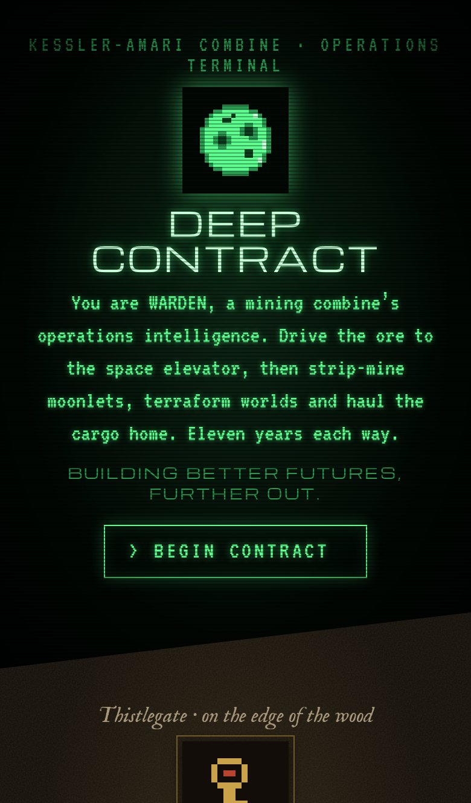
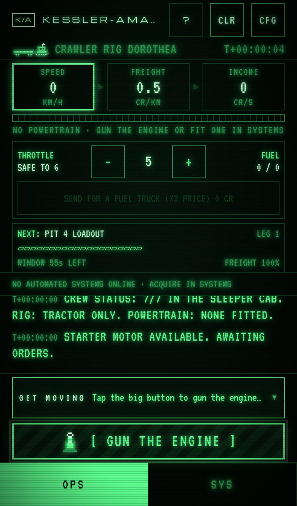
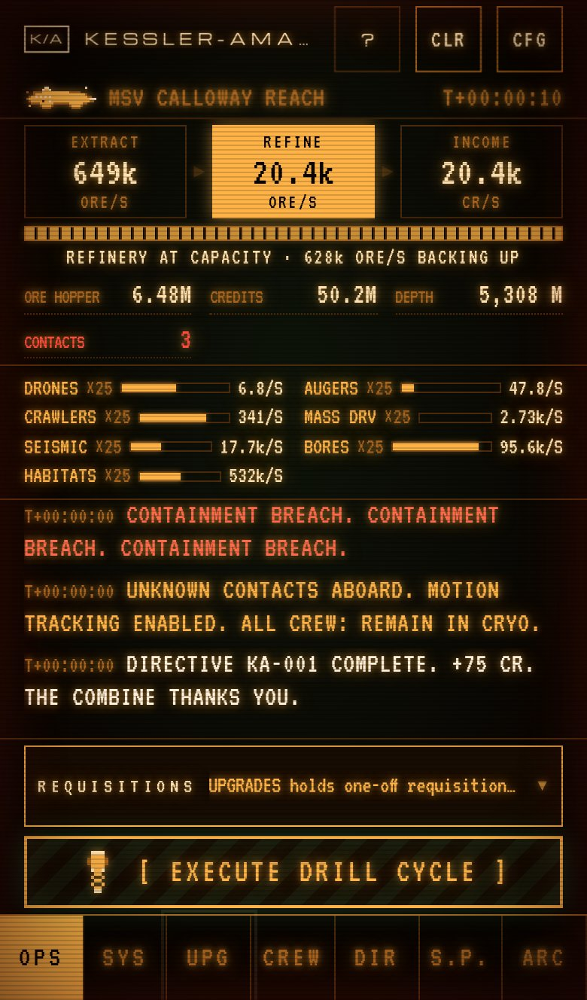
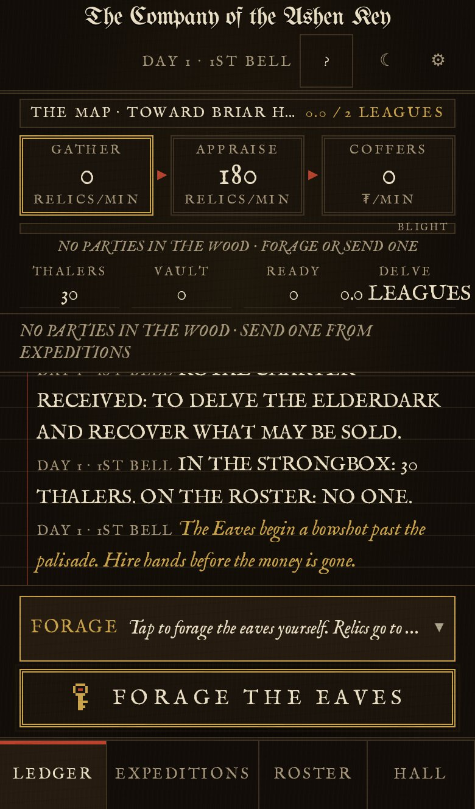
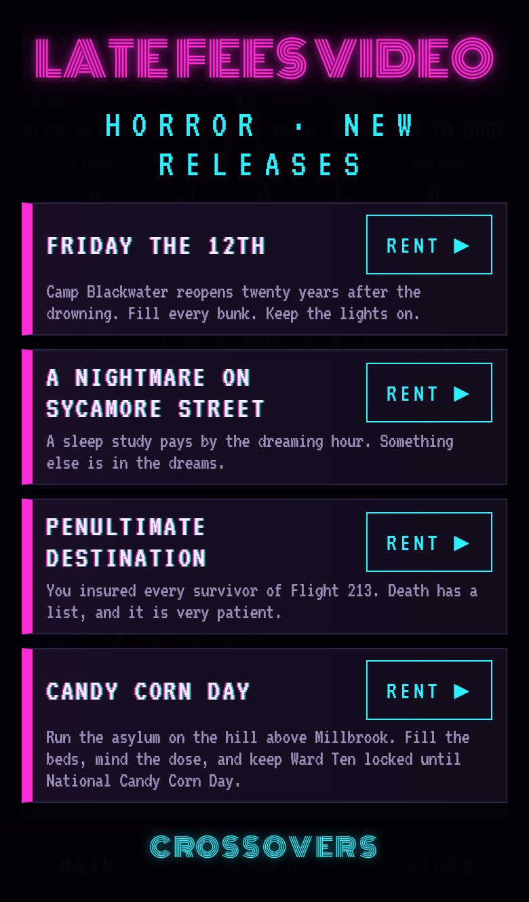
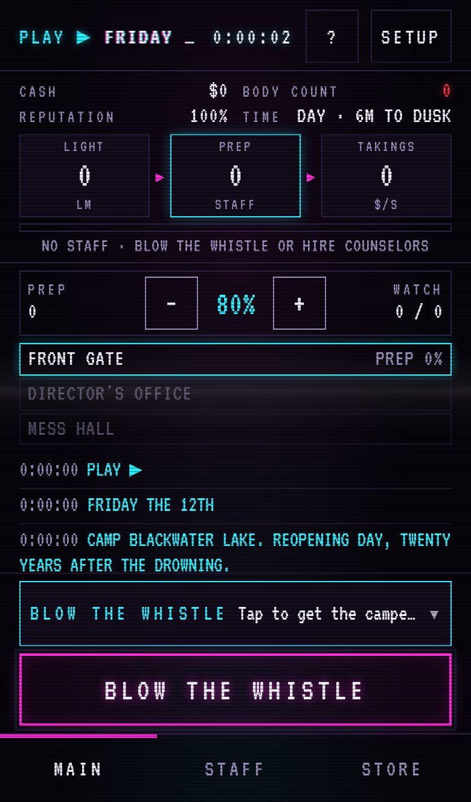
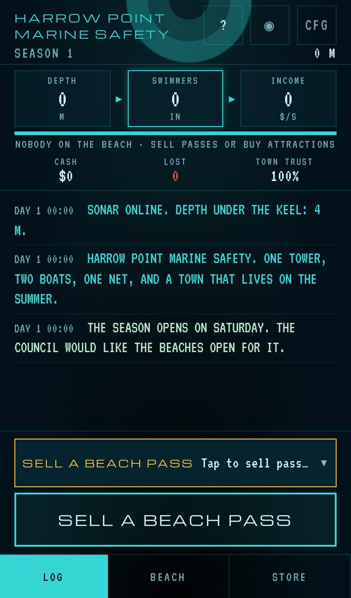
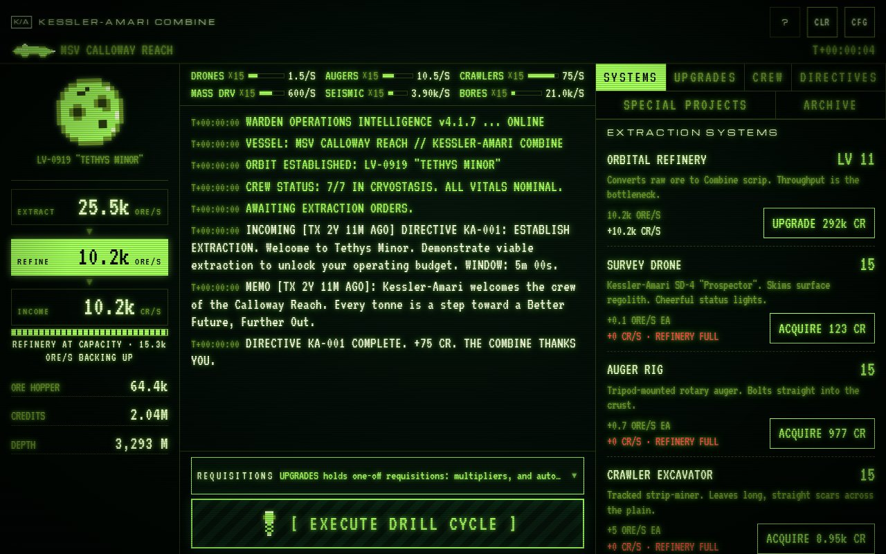

# DEEP CONTRACT, CHARTER OF THE ELDERDARK, LATE FEES & DOWN THERE

Four horror idle games that run entirely in the browser, on a phone or a desktop. **Play: https://rayners.github.io/clicker/**

  
  
  

- **DEEP CONTRACT** (`/contract/`): a retro-futurist idle clicker. You are WARDEN, the operations intelligence of the
  Kessler-Amari Combine, running contracts out past the edge of light-lag: a crawler haul to the space elevator,
  strip-mining a moonlet, terraforming, colony security, long-haul freight, salvaging a derelict. It is a cheerful
  corporate job for the first couple of hours, until it isn't. Later, WARDEN is promoted to the Boardroom and sends
  crews out itself.
- **CHARTER OF THE ELDERDARK** (`/forest/`): dark-fantasy company management. Keep the ledger of a treasure-hunting
  company on the edge of a corrupting forest, assault a drowned keep, and count who comes back.
- **LATE FEES** (`/late-fees/`): slasher homages on a 1988 video store shelf. Run a summer camp, a sleep clinic, an
  insurer or an asylum while the body count climbs; every film gets a sequel, and killers cross over between tapes.
- **DOWN THERE** (`/down-there/`): run a resort town's marine safety office, from sharks off the beach down to
  whatever is coming up out of the trench.

Each game also has a tier where you play as the horror, unlocked by finishing runs.

There is also **CLIP WORKS** (`/clips/`), the classic paperclip game, built from the engine's documentation alone as
its example ([`src/clips/README.md`](src/clips/README.md)).

  
  
  

  
  

## How it's built

There is no backend. Saves live in `localStorage` (with export and import codes for moving between devices), and
the site is a static, installable, offline-capable PWA in which each game installs as its own app. Pushes to `main`
are tested and deployed to GitHub Pages. The only outbound traffic is optional, anonymous telemetry
([`docs/TELEMETRY.md`](docs/TELEMETRY.md)), which can be turned off in each game's settings.

The games are written in TypeScript with Vite and no UI framework, and built test-first (vitest, plus Playwright on
desktop Chromium and iPhone emulation). Bots play every scenario headlessly so the pacing of each act stays on target.

They were built by [David Raynes](https://github.com/rayners), who has been writing software for 30 years, together
with Claude (Anthropic's AI model) in Claude Code. The [About page](https://rayners.github.io/clicker/about/) says
more, and has the tip jar.

## Commands

| | |
|---|---|
| `npm run dev` | Dev server. Add `-- --host` to open it on a phone on the same network. |
| `npm test` | Unit and UI tests (vitest, jsdom), including the pacing goals. `npx tsc --noEmit` for types. |
| `npm run test:e2e` | Playwright journeys on desktop Chromium and iPhone 13 emulation. Set `E2E_WEBKIT=1` to use real WebKit (needs `sudo npx playwright install-deps webkit`). |
| `npm run simulate [scenario] [horror]` | Headless bot playthrough of DEEP CONTRACT; prints when each act and the terminus are reached. |
| `npm run simulate:board` | The same for the Boardroom. |
| `npm run simulate:forest [keep] [hours]` | The same for Elderdark. |
| `npm run simulate:late [venue] [killer]` | The same for LATE FEES. |
| `npm run build` | Typecheck and static build to `dist/` (with service worker). |
| `npm run icons` | Regenerate the PWA icons from the pixel sprites. |
| `npm run screenshots` | Retake the README screenshots from a running dev server. |
| `npm run docs` | Generate the engine's API reference into `dist/engine/` (published at `/engine/`). |

Dev builds have debug jumps (e.g. `/contract/?debug=act4`, `/forest/?debug=keep`, `/late-fees/?debug=member`);
[`CLAUDE.md`](CLAUDE.md) lists them all.

## Layout

- `index.html`, `src/picker/`: the front page that picks a game, and the About page.
- `src/engine/`: the engine every game runs on (the page shell, saves, store, story, held-ground and hunt engines,
  walkthrough, sound, sprites, telemetry). It imports nothing from the games, and no game imports another. See
  [its README](src/engine/README.md) and the [API reference](https://rayners.github.io/clicker/engine/).
- DEEP CONTRACT:
  - `src/mission/`: one self-contained, JSON-serializable contract (scenarios × horrors, crew, directives, story).
    No DOM, globals or wall-clock time, so the Boardroom can run many at once.
  - `src/core/`: game state, offline catch-up, saves and migrations, prestige, the Boardroom, the horror tiers.
  - `src/data/`: content tables (systems, upgrades, crew, directives, story beats, archive files, sprites).
  - `src/ui/`: framework-free DOM panels, canvas sprites, motion tracker, sound.
  - `src/sim/`: the pacing bots used by `tests/sim/pacing.test.ts`.
- `src/forest/`, `src/forest-data/`, `src/forest-ui/`: Elderdark (simulation, content, ledger UI).
- `src/late-fees/`, `src/late-fees-data/`, `src/late-fees-ui/`: LATE FEES (venues × killers, content, VHS UI).
- `src/clips/`, `src/clips-ui/`: CLIP WORKS, the engine's example game (engine imports only).
- `src/fathom/`, `src/fathom-data/`, `src/fathom-ui/`: DOWN THERE (working title FATHOM in code; sonar UI).

## Docs

- [`src/engine/README.md`](src/engine/README.md): what the engine offers and how a game plugs into it; the
  [API reference](https://rayners.github.io/clicker/engine/) is generated from its doc comments.
- [`docs/DESIGN.md`](docs/DESIGN.md): DEEP CONTRACT's premise, systems, acts and pacing, prestige, UI direction.
- [`docs/TERRAFORM.md`](docs/TERRAFORM.md): the terraforming scenario and the scenario × horror architecture.
- [`docs/MISSIONS.md`](docs/MISSIONS.md): security, haulage, salvage and the shared held-ground engine.
- [`docs/OUTBREAK.md`](docs/OUTBREAK.md): the second horror, a pathogen in the workforce.
- [`docs/BOARDROOM.md`](docs/BOARDROOM.md): the second tier, at headquarters.
- [`docs/HORROR-TIER.md`](docs/HORROR-TIER.md): the play-as-the-horror tier in every game.
- [`docs/forest/DESIGN.md`](docs/forest/DESIGN.md): Elderdark's design and status.
- [`docs/late-fees/DESIGN.md`](docs/late-fees/DESIGN.md): LATE FEES's design and status.
- [`docs/kaiju/DESIGN.md`](docs/kaiju/DESIGN.md): DOWN THERE's design and status.
- [`docs/TELEMETRY.md`](docs/TELEMETRY.md): anonymous analytics and exactly what is sent.
- [`docs/ROADMAP.md`](docs/ROADMAP.md): status, deviations from the plan, backlog, balance notes.
- [`CLAUDE.md`](CLAUDE.md): working rules (strict TDD, phone and desktop first-class, no backend, mission isolation).
